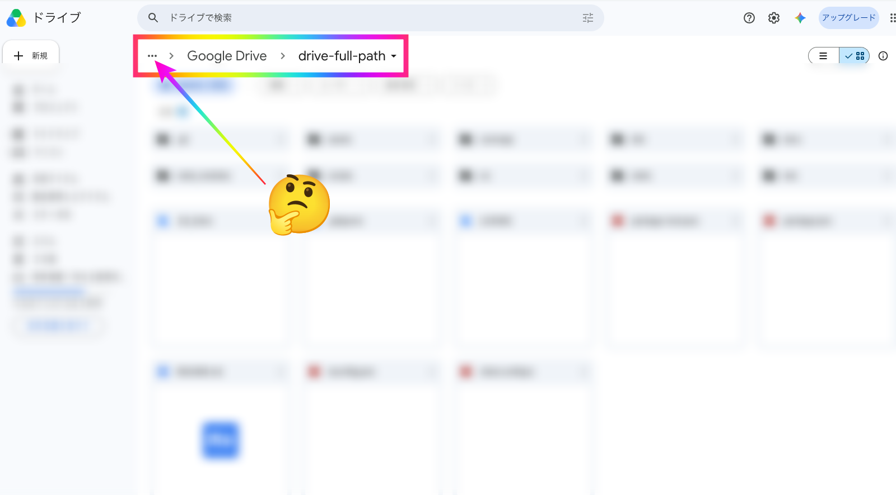
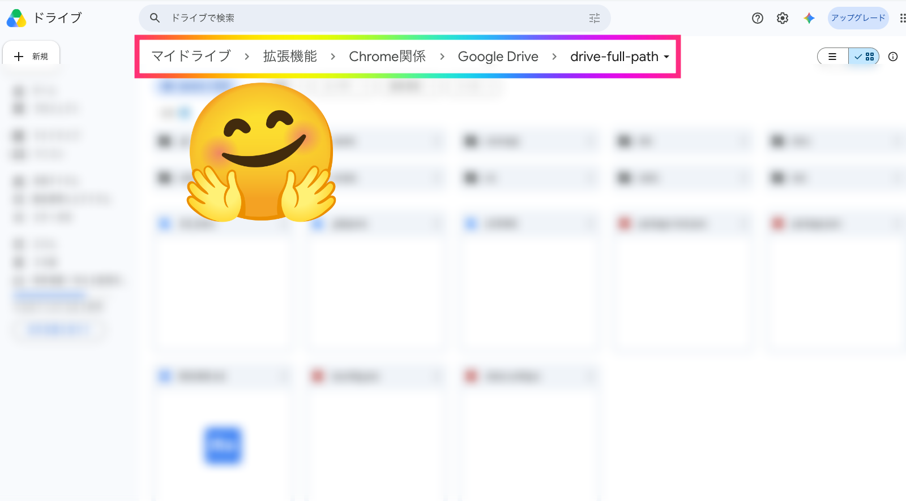
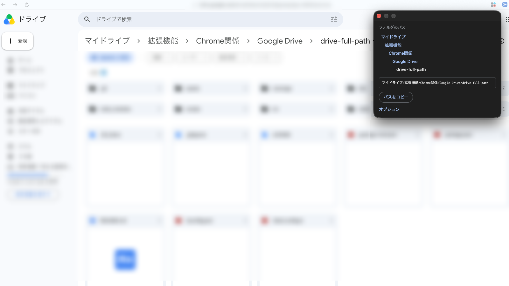

# Full Path for Google Drive

Googleドライブ（Web版）のパンくずで「...」に隠れる上位フォルダを、常にパンくずへ展開して表示するChrome拡張機能（MV3）。拡張機能のアイコンのポップアップでは全階層の一覧と、フルパスのコピーができる。コピーするパスの先頭に付ける文字と区切り文字（`/`または`\`、既定は`/`）はオプション画面で設定する。

- DriveのDOMだけで動く。OAuth・Drive APIは使わない。
- Driveは4階層以上のパスを「...」と直近2階層に省略する。拡張機能は「...」のメニューを画面に出さずに開いて隠れた階層を読み、パンくずへ差し込む。
- 差し込んだ階層と、ポップアップの各階層はクリックでそのフォルダへ移動する。

## 画面

拡張機能なし：上位フォルダが「...」に隠れ、今どこにいるか分からない。



拡張機能あり：「...」が展開され、マイドライブからの全階層がパンくずに並ぶ。



ポップアップ：全階層の一覧と、コピーされるパスの確認、コピーができる。



## 開発

```
npm install
npm test               # 単体テスト（Vitest + jsdom）
npm run test:coverage  # カバレッジ付き（閾値80%）
npm run typecheck
npm run build          # dist/ に出力
```

## 読み込み

1. `npm run build`
2. `chrome://extensions`でデベロッパーモードをオンにする。
3. 「パッケージ化されていない拡張機能を読み込む」で`dist/`を選ぶ。

ソースを変えたら`npm run build`し、`chrome://extensions`で拡張機能を再読み込みしてからDriveのタブを再読み込みする。

## 構成

- `src/content/`: Driveのページで動くcontent script。
  - `breadcrumb.ts`: パンくずの読み取り。
  - `menu.ts`: 「...」メニューの開閉と読み取り。
  - `inline.ts`: パンくずへの差し込み。
  - `navigate.ts`: フォルダ移動。
  - `controller.ts`: Driveの再描画・フォルダ移動への追従。
- `src/popup/`: ポップアップ。
- `src/options/`: オプション画面（コピーするパスの接頭辞と区切り文字）。
- `src/shared/`: パスの整形、設定の読み書き、メッセージの型と検査。
- `static/`: manifest、HTML、CSS、アイコン、`_locales`（en/ja）。
- `assets/icon.svg`: アイコンの原本。
- `docs/privacy.md`: プライバシーポリシー（Chromeウェブストアに載せるURLの元）。
- `docs/images/`: READMEの画面の画像。
- `test/fixtures/drive.ts`: Driveのパンくずを模したDOM（フォルダ名はダミー）と、「...」メニューの挙動の模倣。

## Driveへの依存

難読化されたclass名は使わず、次の属性だけに依存する。aria-labelは表示言語で変わるため要素の特定には使わない。

- `nav[guidedhelpid="folder_path"]`
- `[data-target="collapsedFolderButton"]`（「...」）
- `[data-target="collapsedFolderDropdown"]`（「...」のメニュー、`<body>`直下）
- `[data-target="folder"][data-id]`、`[role="listitem"]`、`[role="menuitem"]`

## プライバシー

通信はせず、読み取ったフォルダ名は画面の表示とコピーにだけ使う。詳しくは[プライバシーポリシー](docs/privacy.md)。

## ライセンス

[MIT License](LICENSE)

画面の画像の絵文字は[Noto Emoji](https://github.com/googlefonts/noto-emoji)（Google、[Apache License 2.0](https://www.apache.org/licenses/LICENSE-2.0)）。

Google Drive is a trademark of Google LLC.
